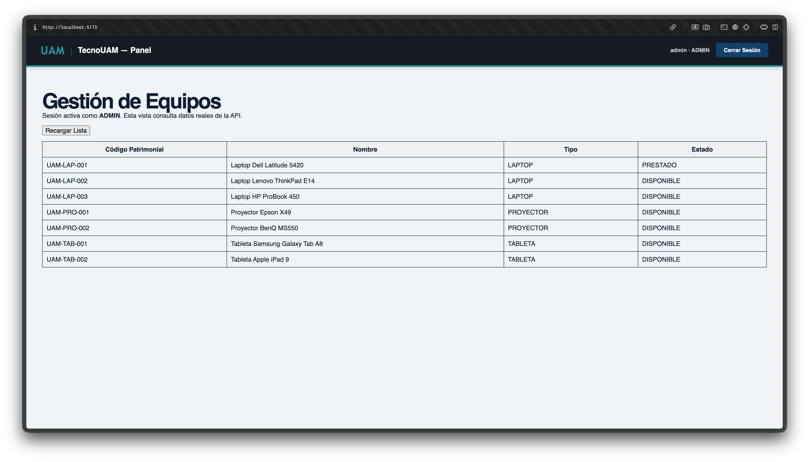
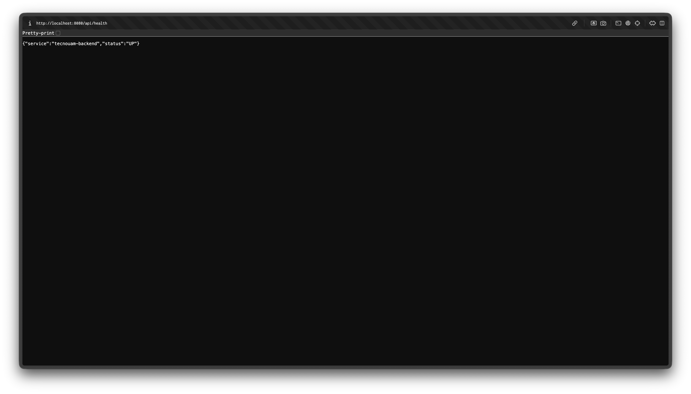

# TecnoUAM

Sistema de préstamo de equipos tecnológicos para el examen integrador de
Servicios Web (segundo corte).

El proyecto se divide en un backend Spring Boot con API REST, persistencia
relacional y seguridad JWT, y un frontend React que consume la API real.

## Propósito y descripción

TecnoUAM es una aplicación académica para administrar el préstamo de equipos
tecnológicos de un centro de capacitación. Permite consultar el inventario,
registrar préstamos, devolver equipos y mantener la disponibilidad sincronizada
entre la base de datos, la API y la interfaz web.

El objetivo del proyecto es demostrar un flujo completo de Servicios Web:

- una API REST desarrollada con Spring Boot;
- persistencia en PostgreSQL administrada desde pgAdmin;
- autenticación con JWT y autorización por roles;
- consumo de datos reales desde React mediante Axios;
- validaciones de negocio, códigos HTTP y pruebas reproducibles.

El alcance corresponde al examen integrador del segundo corte. Las cuentas
incluidas son de demostración académica y no representan un sistema de
usuarios productivo.

## Alcance funcional

| Funcionalidad | Descripción |
| --- | --- |
| Autenticación | Login con `admin` o `user`; la respuesta entrega un JWT y sus roles. |
| Inventario | Consultar, crear, actualizar y eliminar equipos tecnológicos. |
| Préstamos | Registrar préstamos, consultar el historial y devolver préstamos activos. |
| Disponibilidad | Un equipo prestado cambia a `PRESTADO` y al devolverse vuelve a `DISPONIBLE`. |
| Seguridad | Las consultas requieren token; las operaciones administrativas requieren `ADMIN`. |
| Validaciones | Se controlan duplicados, fechas inválidas, equipos ocupados y eliminaciones no permitidas. |

## Arquitectura y flujo

```text
React (localhost:5173)
        |
        | Axios + Authorization: Bearer <JWT>
        v
Spring Boot REST API (localhost:8080)
        |
        | JPA/Hibernate + Flyway
        v
PostgreSQL local (administrable con pgAdmin)
```

El backend es la fuente de verdad. React únicamente consume `GET /api/equipos`
para mostrar el inventario y conserva el token de la sesión en el navegador.
Las operaciones completas de equipos y préstamos pueden demostrarse mediante
Postman.

## Equipo y responsabilidades

| Integrante | Responsabilidad principal | Rama sugerida |
| --- | --- | --- |
| Fernando Reyes | Base del proyecto, integración, pruebas y evidencias | `feature/fernando-integracion` |
| Jorddy Siezar | Entidades, relación JPA, migraciones y datos | `feature/jorddy-modelo-datos` |
| Max Martinez | CRUD, servicios, DTOs y reglas de negocio | `feature/max-api-negocio` |
| Emilio Carranza | Spring Security, JWT y roles | `feature/emilio-seguridad` |
| Victor Cabrera | React, Axios y visualización | `feature/victor-frontend` |

Las responsabilidades son el punto de partida: todos deben conocer el flujo
completo para la defensa técnica. Cada integrante debe realizar sus cambios en
su propia rama y dejar commits identificables con su nombre de usuario de Git.

### Fernando Reyes — coordinación, integración, pruebas y evidencias

Rama: `feature/fernando-integracion`

- mantener la configuración compartida, README y variables de entorno;
- integrar las ramas del equipo en `main` y preparar la entrega final;
- crear y mantener la colección Postman;
- ejecutar los casos funcionales positivos y negativos;
- documentar capturas, resultados y pasos de demostración;
- preparar el guion de defensa técnica y verificar que los cinco integrantes
  tengan aportes demostrables.

Archivos esperados: `README.md`, `CONTRIBUTING.md`, `docs/`,
`postman/` y configuración del proyecto.

### Jorddy Siezar — entidades, relación JPA y base de datos

Rama: `feature/jorddy-modelo-datos`

- implementar las entidades `Equipo` y `Prestamo`;
- definir enums, restricciones, relación entre ambas entidades y nombres de
  columnas;
- crear repositorios Spring Data JPA;
- agregar migraciones o script SQL reproducible;
- incluir datos mínimos para la demostración;
- cubrir con pruebas la persistencia y las restricciones principales.

Archivos esperados: `backend/src/main/java/.../equipo/`,
`backend/src/main/java/.../prestamo/` y `backend/src/main/resources/db/`.

### Max Martinez — API, servicios y reglas de negocio

Rama: `feature/max-api-negocio`

- crear DTOs de entrada y salida;
- implementar servicios y controladores de equipos y préstamos;
- completar el CRUD de equipos;
- validar campos obligatorios y fechas;
- impedir préstamos sobre equipos `PRESTADO`;
- cambiar el estado del equipo al prestar y devolver;
- impedir eliminar equipos con préstamos activos;
- devolver códigos HTTP `201`, `200`, `204`, `400`, `404` y `409` según el
  caso.

Archivos esperados: `backend/src/main/java/.../equipo/`,
`backend/src/main/java/.../prestamo/` y manejo global de errores.

### Emilio Carranza — autenticación, JWT y autorización

Rama: `feature/emilio-seguridad`

- implementar `POST /api/auth/login`;
- configurar autenticación sin sesiones y filtro JWT;
- definir usuarios o cuentas de prueba con roles `USER` y `ADMIN`;
- proteger rutas según el rol requerido;
- mantener el secreto JWT únicamente en variables de entorno;
- verificar los casos `401 Unauthorized` y `403 Forbidden`.

Archivos esperados: `backend/src/main/java/.../security/`, configuración de
usuarios y documentación de variables requeridas.

### Victor Cabrera — React, Axios y visualización

Rama: `feature/victor-frontend`

- construir componentes funcionales con `useState` y `useEffect`;
- configurar Axios y el envío del token válido;
- mostrar la tabla con código patrimonial, nombre, tipo y estado;
- implementar estados de carga, lista vacía y error;
- confirmar que la lista se actualiza al recargar después de crear o prestar
  equipos desde Postman;
- evitar datos simulados como evidencia de integración.

Archivos esperados: `frontend/src/`, configuración de Axios y documentación de
la ejecución del frontend.

### Dependencias entre responsabilidades

```text
Fernando: base y contratos
       |
Jorddy: modelo y base de datos
       |
Max: API y reglas de negocio
       |
Emilio: seguridad y JWT
       |
Victor: consumo real desde React
       |
Fernando: pruebas, evidencias e integración final
```

Cada integrante debe revisar al menos una tarea de otro compañero y explicar
su parte durante la defensa. La división organiza el trabajo, pero no limita
el conocimiento que debe tener el equipo completo.

## Requisitos locales

- Java 21 o superior
- Maven 3.9 o superior
- Node.js 20 o superior y npm
- PostgreSQL 15 o superior
- pgAdmin 4 (opcional, para administrar visualmente PostgreSQL)

## Inicio rápido

1. Copiar las variables de entorno de ejemplo:

   ```bash
   cp .env.example .env
   ```

2. Crear la base de datos desde pgAdmin:

   - Conéctate al servidor local `localhost:5432`.
   - Crea una base de datos llamada `tecnouam`.
   - Usa en `.env` las mismas credenciales de esa instalación.

   pgAdmin administra PostgreSQL; el servidor PostgreSQL debe estar instalado y
   ejecutándose en la computadora.

3. Iniciar el backend:

   ```bash
   cd backend
   mvn spring-boot:run
   ```

   Flyway crea las tablas y carga los datos demo de
   `backend/src/main/resources/db/migration/`.

4. En otra terminal, instalar dependencias e iniciar React:

   ```bash
   cd frontend
   npm install
   npm run dev
   ```

El frontend queda en `http://localhost:5173` y el backend en
`http://localhost:8080`.

## Probar el login en React

Abre `http://localhost:5173` después de iniciar backend y frontend.

### Como administrador

```text
Usuario: admin
Contraseña: admin123
```

La cabecera mostrará `admin · ADMIN`. El administrador tiene permisos para
crear, actualizar y eliminar equipos, registrar préstamos y devolverlos. Las
operaciones administrativas se demuestran en Postman.

### Como usuario

Cierra sesión y usa:

```text
Usuario: user
Contraseña: user123
```

La cabecera mostrará `user · USER`. Puede consultar la lista de equipos en
React, mientras que el backend rechazará las operaciones administrativas con
`403`. La consulta de préstamos y las diferencias completas entre roles se
demuestran en Postman.

## Probar con Postman

Importa `postman/TecnoUAM.postman_collection.json` y ejecuta las carpetas en
este orden:

1. `01 - Autenticación` obtiene y guarda automáticamente los tokens de
   `admin` y `user`.
2. `02 - Seguridad` comprueba `401`, `403` y consulta autenticada.
3. `03 - Equipos` crea, consulta y actualiza equipos.
4. `04 - Préstamos y devolución` prueba préstamo duplicado, eliminación
   bloqueada, devolución, liberación y eliminación permitida.

La colección genera códigos y fechas de prueba automáticamente. Sus variables
se almacenan en la colección, por lo que no hay que copiar manualmente los
tokens entre solicitudes.

## Guía de demostración para el profesor

### 1. Preparar el entorno

1. Verifica que PostgreSQL esté iniciado y que exista la base de datos
   `tecnouam`.
2. Revisa las credenciales de conexión en `.env`. pgAdmin administra el
   servidor, pero el servicio PostgreSQL debe estar instalado y ejecutándose.
3. Inicia backend y frontend siguiendo la sección [Inicio rápido](#inicio-rápido).
4. Comprueba la API visitando `http://localhost:8080/api/health`. Debe
   responder:

   ```json
   {"status":"UP","service":"tecnouam-backend"}
   ```

### 2. Demostrar los roles en React

1. Abre `http://localhost:5173`.
2. Ingresa con `admin` / `admin123`. La cabecera debe mostrar `admin · ADMIN`
   y la tabla debe cargar los equipos desde la API.
3. Cierra sesión e ingresa con `user` / `user123`. La cabecera debe mostrar
   `user · USER` y el inventario debe seguir visible.
4. Explica que React consulta datos reales, mientras el backend conserva la
   autoridad sobre los permisos.

### 3. Demostrar endpoints y reglas de negocio

Importa la colección de Postman y ejecuta sus carpetas en orden. El profesor
puede observar en cada respuesta el código HTTP y el cuerpo JSON:

1. `01 - Autenticación`: logins correctos de ambos roles y login incorrecto
   (`200`, `200` y `401`).
2. `02 - Seguridad`: solicitud sin token (`401`), consulta como `USER` (`200`)
   e intentos administrativos como `USER` (`403`).
3. `03 - Equipos`: creación (`201`), consulta (`200`) y actualización (`200`).
4. `04 - Préstamos y devolución`: creación (`201`), préstamo duplicado (`409`),
   eliminación bloqueada (`409`), devolución (`200`), liberación del equipo
   (`DISPONIBLE`) y eliminación final (`204`).

La colección genera códigos únicos y fechas relativas al día de ejecución. No
es necesario copiar JWT manualmente: los scripts de Postman guardan los
tokens en variables de colección.

### Pruebas manuales equivalentes con cURL

Estas solicitudes permiten repetir la demostración sin Postman. Primero inicia
sesión y copia únicamente el valor de `token` de la respuesta:

```bash
curl -X POST http://localhost:8080/api/auth/login \
  -H 'Content-Type: application/json' \
  -d '{"username":"admin","password":"admin123"}'
```

Luego reemplaza `<TOKEN_ADMIN>`:

```bash
curl http://localhost:8080/api/equipos \
  -H 'Authorization: Bearer <TOKEN_ADMIN>'
```

Para verificar autorización, repite una operación de escritura con el token de
`user`; la respuesta esperada es `403 Forbidden`.

## Evidencias de pruebas

Ejecución realizada el 30 de octubre de 2026 contra PostgreSQL local
(PostgreSQL 17.10), con Java 27.0.1 compilando para Java 21 y Spring Boot
3.5.6.

### Pruebas automatizadas

Desde `backend/`:

```text
mvn test
Tests run: 14, Failures: 0, Errors: 0, Skipped: 0
BUILD SUCCESS
```

Estas pruebas cubren JWT, persistencia y migraciones Flyway, reglas de negocio
y la regresión de logins consecutivos después de que Spring elimine las
credenciales de una sesión.

### Pruebas HTTP

El flujo funcional se ejecutó contra `http://localhost:8080/api` y pasó los 17
casos siguientes:

| Caso | Resultado |
| --- | --- |
| Health público | `200` |
| Equipos sin token | `401` |
| Credenciales inválidas | `401` |
| Login `ADMIN` y rol `ROLE_ADMIN` | `200` |
| Login `USER` y rol `ROLE_USER` | `200` |
| Segundo login `USER` | `200` |
| `USER` consulta equipos | `200` |
| `USER` intenta crear equipo | `403` |
| `ADMIN` crea equipo | `201` |
| `USER` intenta registrar préstamo | `403` |
| `ADMIN` registra préstamo | `201` |
| Segundo préstamo del mismo equipo | `409` |
| Eliminar equipo con préstamo activo | `409` |
| `USER` consulta préstamos | `200` |
| `ADMIN` devuelve préstamo | `200` |
| Equipo liberado queda `DISPONIBLE` | `200` |
| Eliminar equipo liberado | `204` |

Los tokens se validaron en cada solicitud, pero se ocultaron en la salida y en
las capturas. El equipo creado por el flujo de evidencia se devolvió y luego se
eliminó.

### Capturas

Las siguientes evidencias fueron tomadas con la aplicación ejecutándose en
`localhost`, con la extensión de modo oscuro desactivada. Muestran la interfaz
React y la respuesta real del backend; no son capturas del editor ni de T3
Code.






## Variables de entorno

El archivo `.env.example` documenta las variables necesarias. Nunca se deben
subir `.env`, contraseñas reales ni secretos JWT al repositorio.

## Flujo de ramas y commits

Cada integrante trabaja en su rama y abre un pull request hacia `main`.
Los commits deben ser pequeños, verificables y seguir esta forma:

```text
tipo(alcance): descripción breve en imperativo
```

Ejemplos: `feat(equipos): agrega validación de código patrimonial` o
`test(api): cubre conflicto al prestar equipo ocupado`.

Antes de abrir un pull request:

```bash
git fetch origin
git rebase origin/main
git status
```

## Estado actual

La base actual contiene configuración compartida, migraciones Flyway para
PostgreSQL local, backend Spring Boot con JWT, frontend React autenticado,
colección Postman y documentación de pruebas.

## Endpoints objetivo

Todas las rutas parten de `http://localhost:8080`. Excepto health y login,
requieren la cabecera `Authorization: Bearer <JWT>`.

| Método | Ruta | Acceso | Uso / respuesta exitosa |
| --- | --- | --- | --- |
| `GET` | `/api/health` | Público | Verifica que el backend esté activo (`200`). |
| `POST` | `/api/auth/login` | Público | Genera JWT y roles (`200`). |
| `GET` | `/api/equipos` | `USER`, `ADMIN` | Lista el inventario (`200`). |
| `GET` | `/api/equipos/{id}` | `USER`, `ADMIN` | Consulta un equipo (`200`). |
| `POST` | `/api/equipos` | `ADMIN` | Crea equipo (`201`). |
| `PUT` | `/api/equipos/{id}` | `ADMIN` | Actualiza equipo (`200`). |
| `DELETE` | `/api/equipos/{id}` | `ADMIN` | Elimina equipo (`204`) si no tiene préstamo activo. |
| `GET` | `/api/prestamos` | `USER`, `ADMIN` | Lista préstamos (`200`). |
| `POST` | `/api/prestamos` | `ADMIN` | Registra préstamo (`201`). |
| `PUT` | `/api/prestamos/{id}/devolver` | `ADMIN` | Devuelve préstamo y libera equipo (`200`). |

### Cuerpos JSON principales

Login:

```json
{
  "username": "admin",
  "password": "admin123"
}
```

Crear o actualizar equipo:

```json
{
  "codigoPatrimonial": "UAM-LAP-010",
  "nombre": "Laptop de demostración",
  "tipo": "LAPTOP"
}
```

Registrar préstamo:

```json
{
  "equipoId": 1,
  "nombreSolicitante": "Carlos Pérez",
  "fechaPrestamo": "2026-10-30",
  "fechaPrevistaDevolucion": "2026-11-06"
}
```

Los tipos disponibles son `LAPTOP`, `PROYECTOR` y `TABLETA`. Las fechas usan
el formato ISO `YYYY-MM-DD`. Los errores de validación o de reglas de negocio
se devuelven como JSON con información del estado y el mensaje correspondiente.

## Cuentas demo

Las cuentas están pensadas únicamente para la demostración académica y se
mantienen en memoria:

| Usuario | Contraseña | Rol |
| --- | --- | --- |
| `admin` | `admin123` | `ADMIN` |
| `user` | `user123` | `USER` |

## Criterios de aceptación

- Las respuestas usan `201`, `200`, `204`, `400`, `401`, `403`, `404` y `409`
  según corresponda.
- Un equipo prestado no puede prestarse de nuevo.
- Devolver un préstamo libera el equipo.
- Un equipo con préstamos activos no puede eliminarse.
- React consulta datos de la API con un JWT real y no usa datos simulados.
- Postman incluye los casos positivos y negativos exigidos por el examen.
